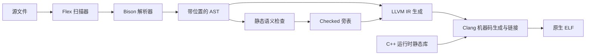

# 架构与源码导航

## 编译流程

## 模块与阅读入口

| 模块 | 入口 | 输入 → 输出 |
| --- | --- | --- |
| 命令行 | `src/driver/main.cpp::main` | 参数 → 选择导出、检查或编译流程 |
| 词法 | `src/frontend/lexer.l`、`LexerState::advance` | 字节 → 带位置 token |
| 语法 | `src/frontend/parser.y` | token → 独占所有权 AST |
| AST | `src/ast/ast.hpp`、`json.cpp` | 节点定义、可观察的 JSON |
| 语义 | `src/sema/check.cpp::Checker::run` | AST → 类型/变量编号/捕获等旁表 |
| IR | `src/ir/emit.cpp::emit` | 同一棵 AST + Checked → 文本 LLVM IR |
| 后端 | `src/backend/build.cpp::build` | IR + runtime archive → ELF |
| 运行时 | `runtime/runtime.cpp` | I/O、数值检查、复合值、线程池、入口 |

## 关键数据与生命周期

- `Program` 拥有多个 `SourceFile`；节点用 `unique_ptr` 组成树。`SourceSpan` 保留文件、字节偏移及行列，末尾位置不包含在范围内。
- `Checked` 是旁表，不改写语法树。`types` 保存表达式原类型，`bindings` 保存名字对应的变量编号，`promotions` 记录 int → float 的转换位置。
- 旁表键包含 AST 节点地址，因此 Program 必须在检查和 IR 生成期间保持存活。不能释放树后再使用 Checked。
- 源语言值的 ABI 为 `i64`：整数直接存储、bool 为 0/1、float 保存 binary64 位模式、字符串/复合值保存句柄。静态类型决定调用哪个接口，不是动态类型系统。

## 语义检查的三个重点

1. **初始化数据流**：每个作用域有绑定和 initialized 状态；if 分支从共同状态出发，结束时取所有未 return 路径的交集。循环可能不执行，不能让循环内赋值保证循环外初始化。
2. **原型和递归**：先收集所有声明并匹配签名，再检查函数体。对每个函数沿调用图搜索能否回到自己；处于递归环的函数必须有定义前的显式原型。
3. **并行副作用**：map 内临时把外层绑定设为只读，之后恢复。调用图反复传播 I/O 和启动并行的属性，直到集合不再变化，再检查 map 的调用是否合法。

## 并行执行与等待

编译器将 map 体生成独立 `map_*` LLVM 函数，通过环境对象传递捕获。输入只求值一次，运行时等待结束后再返回结果。

线程池队列存放少量工作任务；各任务通过原子下标领取输入元素。结果数组预先分配，每个下标只由一个工作者写入，不需要结果槽锁。错误记录另用锁保护，保存最小失败下标，最终由调用线程重抛。

`remaining`、条件变量及环境引用属于本次 map 调用的栈状态。最后一个任务必须在锁内减少计数并通知；调用线程拿到同一把锁并观察到零后才可结束等待，防止通知时条件变量已经销毁。

## 值语义与局限

数组和结构体在赋值、传参及返回等位置深复制；字符串不可修改，可共享。辅助函数修改自己的参数不会修改调用方，因此不能通过这种别名绕过只读捕获。

当前采用分线程、进程生命周期内存区域，程序结束统一释放；工作线程创建的结果不会随回调结束失效，但临时值可能累积。全程序变量编号对应 alloca，尚未优化局部槽分配。没有垃圾收集、SSA 提升、自定义优化、增量编译或独立模块链接。算法套件未发布，课程最终验收仍待进行。
